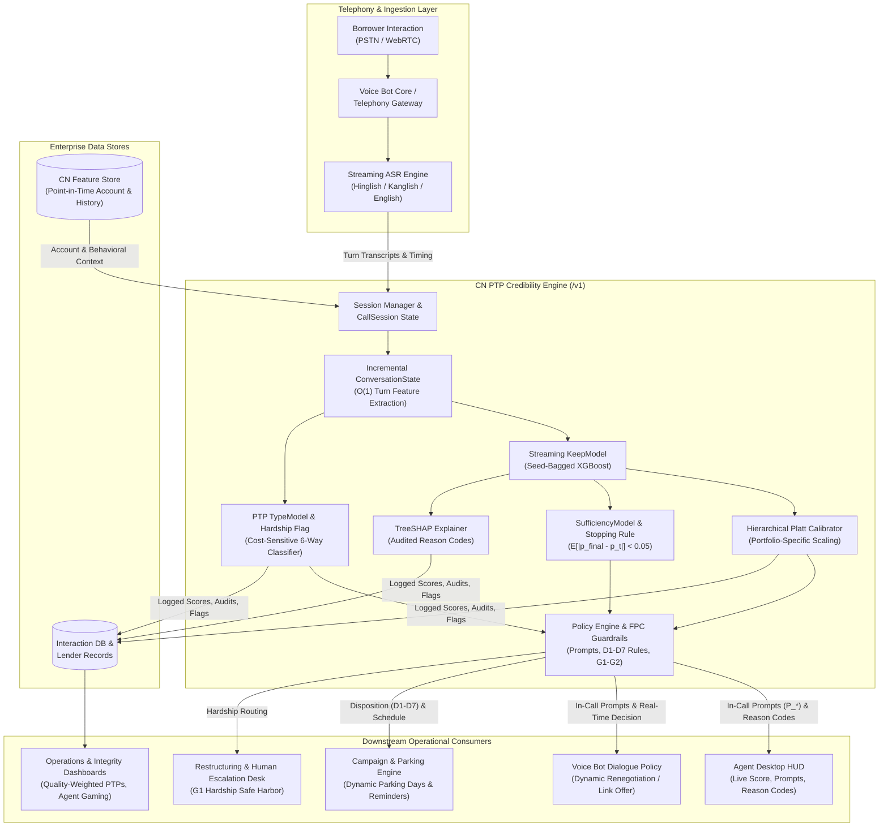
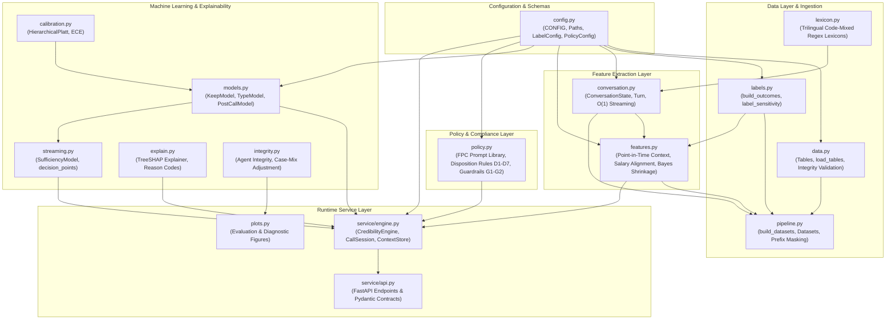
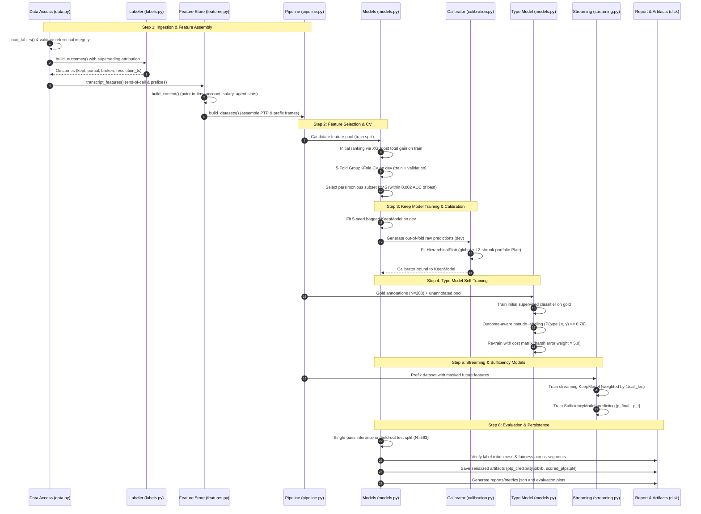
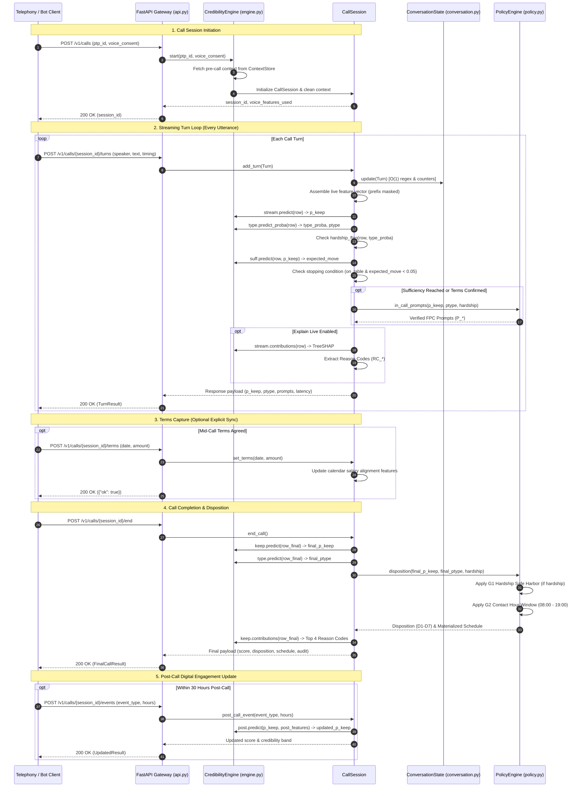

# Real-Time Promise-to-Pay (PTP) Credibility Architecture

This document describes the architectural design, component interactions, data pipelines, and operational deployment of the Real-Time Promise-to-Pay (PTP) Credibility System for the CreditNirvana (CN) collections platform.

---

## 1. System Overview

### 1.1 Problem Statement and Operational Context
In debt collections operations, over half of captured Promises-to-Pay (PTPs) are broken. Traditional collection systems apply a uniform operational policy: once a debtor promises to pay, the account is "parked" until the promised date, halting all outbound outreach. When unviable or deceptive promises are parked for extended periods (e.g., 7 to 15 days), collections momentum is lost, roll rates to higher Days Past Due (DPD) buckets increase, and operational costs escalate. Conversely, subjecting borrowers in genuine financial distress to aggressive reminders damages customer relationships and violates fair practice guidelines.

The CreditNirvana Real-Time PTP Credibility Engine addresses these challenges by evaluating the credibility of a promise *during* the interaction and immediately post-call. It classifies the promise into behavioral archetypes, provides fair-practice compliant in-call prompts to firm up weak commitments, truncates unearned parking windows, and routes vulnerable borrowers to restructuring desks.

### 1.2 CreditNirvana Platform Integration
The credibility engine operates as a low-latency microservice integrated into the broader CreditNirvana collections ecosystem. It consumes live transcription streams from the automated voice bot and human telephony stacks, enriches them with point-in-time account history, and emits real-time guidance to conversational agents and downstream automation workflows.



### 1.3 Data Flow Lifecycle
1. **Call Initialization**: Upon dialing or call connect, the telephony or agent desktop client requests a session via `POST /v1/calls`, providing the `ptp_id` and the customer's Digital Personal Data Protection (DPDP) consent status (`voice_consent`). Pre-call account characteristics, prior payment trajectories, and agent track records are fetched from the feature store.
2. **Turn-by-Turn Streaming**: As the borrower and agent/bot speak, the Automatic Speech Recognition (ASR) system emits completed turns. Each turn is posted to `POST /v1/calls/{session_id}/turns`. The engine executes incremental regex lexicon matching, updates conversation features, generates streaming predictions, and evaluates sufficiency.
3. **Mid-Call Action Trigger**: When a promise is placed on the table and the sufficiency model confirms score stability, the policy engine emits Fair Practices Code (FPC) compliant prompt recommendations (`P_HARDSHIP_SUPPORT`, `P_MOVE_AFTER_SALARY`, `P_PART_PAYMENT_LINK`, etc.) directly to the bot or agent screen.
4. **Call Termination**: When the call concludes, the client triggers `POST /v1/calls/{session_id}/end`. The end-of-call keep model scores the final interaction, the disposition engine assigns the account treatment (rules D1–D7) under hardship guardrails (G1–G2), and an RBI-compliant reminder schedule is generated.
5. **Post-Call Enrichment**: Digital borrower engagements occurring after the call (e.g., WhatsApp payment link opened, confirmation reply) are posted via `POST /v1/calls/{session_id}/events`, triggering a Bayesian update of the keep probability.

---

## 2. Module Architecture

The system is organized into decoupled modules following separation of concerns between data ingestion, feature extraction, statistical modeling, governance policy, and network serving.



### 2.1 Module Catalog and Technical Responsibilities

#### [config.py](file:///Users/admin/Documents/OpenIITData/src/ptp_credibility/config.py)
Centralized configuration repository holding all tunable hyperparameters, business definitions, and operational thresholds:
* `Paths`: Defines project directory structures (`ps1_fake_ptp`, `shared`, `artifacts`, `reports`).
* `LabelConfig`: Parameterizes the ground-truth definition of a kept promise (default: 3 grace days, 90% payment threshold, sensitivity grid).
* `PostCallConfig`: Defines the observation horizon (30 hours) for post-call digital events before label determination.
* `PolicyConfig`: Operating thresholds for risk segmentation (`high_credibility = 0.55`, `low_credibility = 0.25`, parking caps, and hardship destinations).
* `ModelConfig`: Specifies XGBoost parameters (`tree_method="hist"`, `learning_rate=0.03`, regularizations) and cross-validation fold parameters.

#### [data.py](file:///Users/admin/Documents/OpenIITData/src/ptp_credibility/data.py)
Data access layer with schema validation and referential integrity checks:
* Loads 12 distinct entities into the `Tables` container: PTP records, call transcripts, post-call events, annotations, accounts, agents, lenders, payments, cross-validation splits, dial attempts, field visits, and addresses.
* Enforces mandatory column presence (`REQUIRED_COLUMNS`), casts data types, and validates cross-table referential integrity (e.g., verifying that all PTP accounts exist in the master accounts table).
* Caches loaded tables via `@lru_cache` to minimize disk I/O overhead.

#### [lexicon.py](file:///Users/admin/Documents/OpenIITData/src/ptp_credibility/lexicon.py)
Trilingual regex extraction patterns spanning Indian English, Hinglish, and Kanglish (romanised Kannada):
* Customer categories (25 regex sets): Identifies expressions of hesitation (`hedge`), preconditions (`conditional`), temporal ambiguity (`vague_date`, `specific_date`), hardship declarations (`hardship_salary`, `hardship_no_funds`, `hardship_business`, `hardship_medical`, `hardship_job_loss`), evasion (`closing_escape`), passive agreement (`passive_agree`), and payment method willingness (`link_accept`, `link_refuse`).
* Agent / Bot categories (11 regex sets): Identifies conversational behaviors including open questions (`open_date_question`), leading suggestions (`proposes_date`), regulatory pressure (`pressure`), instalment asks (`part_payment_ask`), and prior failure references (`mentions_prior_break`).
* Entity extractors: Currency value parsing (`extract_amounts`), calendar day references (`extract_day_numbers`), and filler token counters (`FILLER`).
* Versioned under `LEXICON_VERSION = "2026.10.1"` for reproducibility and regulatory audit trails.

#### [labels.py](file:///Users/admin/Documents/OpenIITData/src/ptp_credibility/labels.py)
Formal implementation of the target label definition:
* `build_outcomes()`: Attributes account payments to captured PTPs within the interval $[t_{\text{capture}}, t_{\text{promised}} + \text{grace\_days} + 1\text{ day})$.
* **Superseding PTP Logic**: When an account generates a newer PTP prior to settlement, the observation window for the antecedent PTP terminates at the newer promise's capture timestamp. This prevents double attribution of a single payment across multiple PTP records.
* Computes outcome statuses: `kept_on_time`, `kept_late_within_grace`, `partial` (25% to 90%), `paid_after_window` (up to 30 days), and `broken`.
* Computes `resolution_ts`, establishing the strict temporal point after which an outcome is considered known.
* `label_sensitivity()`: Evaluates keep-rate fluctuations across permutations of grace windows (0 to 7 days) and repayment thresholds (50% to 100%).

#### [conversation.py](file:///Users/admin/Documents/OpenIITData/src/ptp_credibility/conversation.py)
Streaming conversation state machine designed for $O(1)$ turn-by-turn processing:
* `ConversationState`: Maintains cumulative token counters, turn counts, and interactional markers across the transcript stream.
* Tracks cross-turn behavioral sequences:
  - Date ownership: Verifies whether the borrower stated the date first or merely assented to an agent proposal (`agent_proposed_date_first`).
  - Coercion dynamics: Flags agreements occurring within two turns of agent pressure (`pressure_then_agree`).
  - Agent persistence: Quantifies agent attempts to solicit payment following borrower deferral (`agent_push_after_deferral`).
  - Interaction balance: Computes agent talk share (`agent_talk_share`) and run-length statistics (`agent_consecutive_max`).
  - Confirmation verification: Checks whether recorded amounts/dates align with borrower utterances (`confirm_day_matches_borrower`, `confirm_amount_matches_borrower`).
* Voice & Prosodic Proxies: Aggregates ASR confidence scores, speech rate (characters per second), pre-turn pause durations, and latency to payment questions (`voice_response_pause_to_ask_ms`), prefix-gated under `VOICE_PREFIX = "voice_"`.

#### [features.py](file:///Users/admin/Documents/OpenIITData/src/ptp_credibility/features.py)
Point-in-time contextual feature assembly:
* Account & Credit Signals: Current DPD, EMI size, outstanding debt, bureau band ordinal, and repayment bounce history.
* Terms Geometry: Days to promised date, day-of-month, day-of-week, promised amount to EMI ratio, and overdue amount ratio.
* Exact Calendar Salary Alignment: `salary_alignment()` evaluates the promised date against the borrower's stated or recorded salary day, tracking `salary_gap_days`, `salary_days_to_next_credit`, and flagging `salary_aligned` (0–2 days post-credit) versus `salary_promise_before_credit` (1–5 days pre-credit).
* Leak-Free Historical Aggregations: Computes prior PTP keep rates and broken ratios using only promises with `resolution_ts <= captured_ts`.
* Empirical Bayes Agent Track Record: Computes agent keep rates shrunk toward the portfolio mean ($k=20$ pseudo-records), calculated exclusively on training split accounts to prevent out-of-sample data leakage.
* Field Collection Features: Dwell times, GPS accuracy, family member interaction, repeated photograph detection (`field_photo_reused`), and field note NLP.
* Post-Call Signals: Flags link opening, confirmation replies, and customer inbound calls prior to payment or horizon.

#### [calibration.py](file:///Users/admin/Documents/OpenIITData/src/ptp_credibility/calibration.py)
Statistical calibration infrastructure:
* `HierarchicalPlatt`: Fits an unregularized global Platt scaling model on pooled out-of-fold log-odds, followed by per-portfolio Platt scaling parameters regularized via $L_2$ penalty ($\lambda = 25.0$) toward the global parameters:
  $$\mathcal{L}(\theta) = \text{NLL}(y, \sigma(a z + b)) + \lambda \|\theta - \theta_{\text{global}}\|^2$$
  This allows large portfolios to adjust to local keep baselines while preventing overfitting in thin lending segments.
* `expected_calibration_error()`: Computes equal-mass Expected Calibration Error (ECE) across prediction deciles.

#### [models.py](file:///Users/admin/Documents/OpenIITData/src/ptp_credibility/models.py)
Model training, inference, and serialization logic:
* `KeepModel`: Seed-bagged XGBoost ensemble (5 seeds) utilizing histogram-based tree splitting (`tree_method="hist"`). Employs GroupKFold validation on account IDs to generate out-of-fold probabilities, followed by Hierarchical Platt calibration. Implements native TreeSHAP contribution extraction.
* `TypeModel`: Six-class classifier distinguishing `genuine_feasible`, `genuine_infeasible`, `escape`, `third_party`, `repeat_promiser`, and `agent_recorded_or_pushed`. Implements semi-supervised *outcome-aware self-training*: assigns pseudo-labels to unannotated records using the posterior probability $P(\text{type} \mid \text{features}, \text{outcome})$. Decisions are optimized using an asymmetric cost matrix that penalizes misclassifying hardship as a harsh type with $5\times$ severity.
* `PostCallModel`: Regularized logistic regression updating the in-call log-odds with post-call engagement vectors.
* `mask_for_prefix()`: Zeroes out terms-dependent and end-of-call features for prefix frames where confirmation has not yet occurred, enforcing strict train-serve parity.

#### [explain.py](file:///Users/admin/Documents/OpenIITData/src/ptp_credibility/explain.py)
Explainability and auditability generation:
* Maps raw feature TreeSHAP values into standardized, plain-language reason codes (`RC_*`).
* Aggregates contributions into six core signal families: `what_was_said`, `conversation`, `how_it_was_said` (voice), `account`, `history`, and `agent`.
* Emits top bidirectional drivers: top $K$ factors elevating credibility and top $K$ factors degrading credibility.

#### [policy.py](file:///Users/admin/Documents/OpenIITData/src/ptp_credibility/policy.py)
Rules-based decisioning, FPC adherence, and operational guardrails:
* Banned Phrase Check (`fpc_check`): Automated import-time and runtime regex asserting that prompts contain no threats, legal intimidation, credit bureau coercion, or harassment.
* In-Call Prompt Engine: Selects contextually relevant, empathetic prompts (`P_HARDSHIP_SUPPORT`, `P_MOVE_AFTER_SALARY`, `P_PART_PAYMENT_LINK`, etc.) parameterized with borrower details in English, Hinglish, or Kanglish.
* Disposition Rules (D1–D7):
  - `D1_credible`: High credibility ($\ge 0.55$); standard parking up to due date.
  - `D2_infeasible`: Genuine infeasibility; short parking (3 days), supportive restructuring call.
  - `D3_weak_or_escape`: Low credibility ($< 0.25$) or escape; truncated parking (2 days), rapid part-payment link.
  - `D4_third_party`: Third-party promise; 1-day parking, direct borrower confirmation call.
  - `D5_repeat`: Repeat promiser; truncated parking (3 days), escalation to senior collector.
  - `D6_agent_recorded`: Pushed or agent-recorded promise; 1-day parking, integrity review.
  - `D7_moderate`: Moderate credibility; standard parking with mid-point automated bot check-in.
* Hard Guardrails:
  - `G1_hardship_no_harsher_treatment`: If the hardship flag is active (medical, unemployment, severe business distress, or type probability $\ge 0.35$), harsh treatments are strictly disallowed. The account is redirected to `restructuring_desk_or_human`.
  - `G2_contact_hours_08_19`: Schedules reminders strictly within 08:00 to 19:00 local time, enforcing a maximum frequency of one contact per day.

#### [streaming.py](file:///Users/admin/Documents/OpenIITData/src/ptp_credibility/streaming.py)
Early decision and sufficiency analysis:
* `SufficiencyModel`: Gradient boosted regressor trained on call prefixes to predict expected absolute score movement until call conclusion:
  $$\hat{\Delta}_t = \mathbb{E}\left[\left|p_{\text{final}} - p_t\right| \;\middle|\; \mathbf{x}_t, p_t\right]$$
* Stopping Rule (`promise_on_table` & $\hat{\Delta}_t < 0.05$): Fires as soon as terms have been discussed and expected score variance drops below threshold, allowing in-call intervention before call termination.

#### [pipeline.py](file:///Users/admin/Documents/OpenIITData/src/ptp_credibility/pipeline.py)
Unified dataset construction:
* Combines table loading, outcome labeling, end-of-call transcript feature extraction, context joining, post-call features, and prefix generation into the `Datasets` structure.
* Ensures identical feature computation logic across offline training, cross-validation, and production inference.

#### [integrity.py](file:///Users/admin/Documents/OpenIITData/src/ptp_credibility/integrity.py)
Agent behavior analytics and anti-gaming protection:
* Quality-Weighted PTPs: Replaces raw PTP counts with $\sum p_{\text{keep}}$ per collector.
* Case-Mix Normalization: Compares observed collections against expected collections derived from a baseline model using account and history features only (excluding agent-controlled variables).
* Gaming Indicators: Computes peer-standardized $z$-scores across conversation flags: silent terms share, pressure-then-agree share, end-of-shift volume bunching, copied remarks, and reused field visit photographs.

#### [plots.py](file:///Users/admin/Documents/OpenIITData/src/ptp_credibility/plots.py)
Headless visualization generator producing publication-quality diagnostic graphics for model performance, calibration, streaming accuracy, and agent behavior.

#### [service/engine.py](file:///Users/admin/Documents/OpenIITData/src/ptp_credibility/service/engine.py)
Stateful runtime orchestrator:
* `CredibilityEngine`: In-memory container holding pre-warmed models (`keep`, `stream`, `sufficiency`, `type`, `post`), Platt calibrators, feature lookup indices, and active session dictionaries.
* `CallSession`: Encapsulates single-call lifecycles, maintaining thread-safe `ConversationState`, handling turn updates, enforcing DPDP voice consent masking, executing real-time TreeSHAP contributions, and materializing final dispositions.
* `ContextStore`: In-memory point-in-time account feature repository simulating an enterprise feature store.

#### [service/api.py](file:///Users/admin/Documents/OpenIITData/src/ptp_credibility/service/api.py)
FastAPI HTTP transport layer exposing RESTful contracts, request validation via Pydantic, and session lifecycle endpoints.

---

## 3. Data Pipeline

The data pipeline implemented in [scripts/train.py](file:///Users/admin/Documents/OpenIITData/scripts/train.py) executes end-to-end model development, hyperparameter selection, hierarchical calibration, diagnostic benchmarking, and artifact serialization.



### 3.1 Training Protocol and Split Integrity
* **Split Hierarchy**: Data splits are grouped strictly at the `account_id` level to guarantee that no borrower appears across multiple partitions. The dataset contains 2,572 training accounts, 561 validation accounts, and 563 held-out test accounts.
* **Leakage Prevention**: All historical aggregations (prior borrower PTPs, agent performance baselines) utilize only historical events whose `resolution_ts <= captured_ts`. Agent track-record shrinkage features are computed exclusively from training split accounts.
* **Feature Selection**: Feature importance ranking is determined exclusively on the training partition. The optimal subset size ($k=45$) is selected via 5-fold grouped cross-validation on `dev` (`train` + `validation`), applying the 1-standard-error rule (smallest $k$ within 0.002 AUC of peak).
* **Single-Pass Evaluation**: The held-out test split is evaluated exactly once upon completion of pipeline training, producing headline metrics and confidence bounds.

---

## 4. Inference Pipeline

The live inference pipeline operates inside the call loop, processing incoming audio turns, executing incremental feature calculations, generating predictions, and assessing sufficiency.



---

## 5. API Endpoints

The service exposes six HTTP REST endpoints through FastAPI. All request and response bodies are validated against Pydantic schemas.

| HTTP Method | Path | Request Schema | Response Schema | Description |
|---|---|---|---|---|
| `GET` | `/v1/health` | None | `{"status": str, "versions": dict, "thresholds": dict}` | Service liveness probe. Emits package, lexicon, policy versions, and operating thresholds. |
| `POST` | `/v1/calls` | `StartCall`<br/>`ptp_id`: string<br/>`voice_consent`: bool<br/>`captured_ts`: optional string | `{"session_id": str, "voice_features_used": bool}` | Opens a real-time call scoring session. Binds account context from feature store. |
| `POST` | `/v1/calls/{session_id}/turns` | `TurnIn`<br/>`speaker`: "agent" \| "bot" \| "customer"<br/>`text`: string<br/>`pause_before_ms`: float<br/>`start_ms`: float<br/>`end_ms`: float<br/>`asr_confidence`: float | `TurnResult`<br/>`p_keep`: float<br/>`credibility_band`: string<br/>`likely_type`: string<br/>`type_proba`: dict<br/>`hardship_flag`: bool<br/>`promise_on_table`: bool<br/>`expected_score_movement`: float<br/>`act_now`: bool<br/>`prompts`: list<br/>`reasons`: dict<br/>`latency_ms`: float | Streams a completed interaction turn. Updates conversation state, evaluates sufficiency, and returns live score with prompts. |
| `POST` | `/v1/calls/{session_id}/terms` | `TermsIn`<br/>`promised_date`: string (ISO)<br/>`promised_amount`: float | `{"ok": bool}` | Captures explicit promise terms from the desktop HUD or bot entity extractor to compute salary alignment. |
| `POST` | `/v1/calls/{session_id}/end` | None | `EndCallResult`<br/>`p_keep`: float<br/>`credibility_band`: string<br/>`likely_type`: string<br/>`hardship_flag`: bool<br/>`disposition`: dict<br/>`schedule`: list<br/>`reasons`: dict<br/>`quality_weight`: float<br/>`audit`: dict<br/>`latency_ms`: float | Concludes session. Emits calibrated keep score, final archetype, policy disposition (D1–D7), and compliant reminder schedule. |
| `POST` | `/v1/calls/{session_id}/events` | `EventIn`<br/>`event_type`: string<br/>`hours_after_call`: float | `{"session_id": str, "event": str, "p_keep_updated": float, "credibility_band": str}` | Ingests post-call engagement events (link clicks, WhatsApp replies) occurring within 30 hours to update keep probability. |

---

## 6. Latency Budget

### 6.1 Telephony Turn Turnaround Requirements
In live conversational collections, the voice bot or human agent guidance system must refresh within a conversational pause window. The system latency budget is established at **300 ms** per turn, encompassing network transit, deserialization, feature updates, model inference, TreeSHAP explanation, and policy rule evaluation.

### 6.2 Micro-Component Latency Breakdown
The following table details the computational cost of each processing phase within `add_turn()`:

| Processing Phase | Operation | Computational Complexity | Estimated Latency |
|---|---|---|---|
| Ingestion & Deserialization | FastAPI / Pydantic schema validation | $O(L)$ where $L = \text{text length}$ | 1.0 – 2.0 ms |
| Lexicon Matching | Regex evaluation across 36 compiled patterns | $O(L)$ deterministic search | 0.8 – 1.5 ms |
| ConversationState Update | Incremental counter & temporal feature updates | $O(1)$ constant time | 0.2 – 0.5 ms |
| Context Alignment | Feature vector assembly & salary calendar alignment | $O(1)$ constant time | 1.5 – 3.0 ms |
| Streaming Model Scoring | Seed-bagged XGBoost inference (2 seeds $\times$ depth 3) | Tree traversal across $k=45$ features | 12.0 – 18.0 ms |
| Platt Probability Calibration | Logit transform + sigmoid evaluation | $O(1)$ analytic evaluation | 0.05 – 0.1 ms |
| Archetype Classification | TypeModel inference & cost-matrix risk minimization | Tree traversal across 56 features + $6\times6$ dot product | 8.0 – 14.0 ms |
| Sufficiency Evaluation | SufficiencyModel regression ($\hat{\Delta}_t$) | Tree traversal | 4.0 – 7.0 ms |
| Policy & Prompt Selection | Hardship logic, FPC verification, prompt templating | Rule lookup & string formatting | 0.5 – 1.0 ms |
| Live Explainability (Optional) | Native TreeSHAP calculation across ensemble | Optimized tree-path traversal | 30.0 – 45.0 ms |
| Response Serialization | JSON encoding & HTTP framing | Memory copy | 1.0 – 2.0 ms |
| **Total Turn Processing (Score Only)** | Without real-time TreeSHAP | Composite execution | **$\sim 30 - 50$ ms** |
| **Total Turn Processing (With SHAP)** | Full explanation payload | Composite execution | **$\sim 60 - 95$ ms** |

### 6.3 Empirical Benchmark Results
Empirical benchmarks executed against held-out test calls on single-core CPU hardware (Python 3.11, unbatched execution) via [scripts/benchmark_latency.py](file:///Users/admin/Documents/OpenIITData/scripts/benchmark_latency.py) yielded the following distribution:

| Metric | p50 (Median) | p90 | p95 | p99 | Maximum | Operating Budget |
|---|---|---|---|---|---|---|
| **Turn Update (with Reason Codes)** | **121.75 ms** | **131.02 ms** | **139.79 ms** | **172.72 ms** | **193.80 ms** | 300.00 ms |
| **Turn Update (Score Only)** | **88.16 ms** | **95.24 ms** | **100.55 ms** | **113.43 ms** | **218.33 ms** | 300.00 ms |
| **End-of-Call Processing** | **113.08 ms** | **119.57 ms** | **121.86 ms** | **125.33 ms** | **126.20 ms** | 500.00 ms |

The 99th percentile for live turn evaluation with complete TreeSHAP reason codes (172.72 ms) consumes only 57.6% of the 300 ms budget, confirming real-time feasibility for production deployment.

---

## 7. Deployment Architecture

### 7.1 Containerization and Runtime Specification
The service is containerized as an immutable, non-root Docker microservice optimized for low-latency inference:
* **Base Image**: `python:3.11-slim-bookworm` with system-level OpenMP runtimes (`libgomp1`) for optimized XGBoost thread scheduling.
* **Process Manager**: Gunicorn running Uvicorn workers (`uvicorn.workers.UvicornWorker`).
* **Concurrency Configuration**: Worker count set to $2 \times \text{vCPU} + 1$. Within each worker, asynchronous request handling manages concurrent telephony socket streams.

```dockerfile
FROM python:3.11-slim-bookworm AS base

ENV PYTHONUNBUFFERED=1 \
    PYTHONDONTWRITEBYTECODE=1 \
    PYTHONPATH=/app/src

RUN apt-get update && apt-get install -y --no-install-recommends \
    libgomp1 \
    curl \
    && rm -rf /var/lib/apt/lists/*

WORKDIR /app

COPY requirements.txt .
RUN pip install --no-cache-dir -r requirements.txt

COPY src/ src/
COPY artifacts/ artifacts/

EXPOSE 8080

HEALTHCHECK --interval=15s --timeout=3s --start-period=5s --retries=3 \
    CMD curl -f http://localhost:8080/v1/health || exit 1

CMD ["gunicorn", "ptp_credibility.service.api:app", \
     "--workers", "4", \
     "--worker-class", "uvicorn.workers.UvicornWorker", \
     "--bind", "0.0.0.0:8080", \
     "--timeout", "30"]
```

### 7.2 Cold-Start and Artifact Management
1. **Zero Lazy-Loading**: The application implements FastAPI lifecycle management (`lifespan`). During server startup, `CredibilityEngine()` loads serialized model binaries (`ptp_credibility.joblib`) and pre-populates in-memory lookup indices from `scored_ptps.pkl`.
2. **Memory Footprint**: Total in-memory footprint per worker process is approximately 380 MB, allowing high density in containerized clusters (e.g., Kubernetes nodes or AWS ECS tasks).
3. **Warm-Up Execution**: A synthetic inference execution is performed on startup to trigger JIT compilation of tree traversal loops and regex tables before opening the ingress port.

### 7.3 State Management and Horizontal Scaling
* **Single Pod / In-Memory State**: In standard configuration, `CallSession` objects reside in the worker's internal dictionary, enabling zero-overhead $O(1)$ state lookups. Ingress sticky sessions (session affinity based on `session_id`) route sequential turns for a given call to the same container instance.
* **Distributed Enterprise Scaling**: For multi-zone, highly available deployments across dynamic clusters without sticky sessions, `ConversationState` can be serialized as a JSON string and persisted to a Redis cluster with a 15-minute Time-To-Live (TTL). The session object deserializes state upon turn arrival and writes back the updated counters in under 3 ms.

### 7.4 Security, Governance, and DPDP Compliance
* **Data Minimization**: Raw audio is never ingested or stored by the credibility service. Only derived textual transcript turns, turn durations, and ASR metadata are transmitted.
* **Consent Enforcement**: When `voice_consent=False` is passed at call start, all acoustic features (`voice_mean_pause_ms`, `voice_response_pause_to_ask_ms`, etc.) are stripped and replaced with `NaN`. The model executes its missing-value routing logic, and audit records log `voice_features_used: false`.
* **Reproducibility and Audit Logs**: Every score emitted by the service logs the tri-tuple of active components: `model_version`, `lexicon_version`, and `policy_version`. Coupled with the stored feature vector, any operational score can be deterministically re-evaluated during regulatory audits.
* **Fair Practices Enforcement**: Prompt text outputs are restricted to the vetted template library. Runtime assertions verify that no coercive, intimidating, or non-compliant language enters borrower communications.

---

## 8. Summary Architecture Specification

| Component | Technical Selection | Primary Metric / SLA |
|---|---|---|
| **Programming Runtime** | Python 3.11 / FastAPI / Pydantic v2 | Sub-millisecond routing overhead |
| **Speech & Lexicon Engine** | Compiled Regex Lexicons (Hinglish/Kanglish/English) | 36 keyword categories, ASR error tolerant |
| **Streaming State Machine** | Incremental `ConversationState` | $O(1)$ turn update, zero audio storage |
| **Keep Credibility Model** | 5-Seed Bagged XGBoost (`tree_method="hist"`) | Test AUC: 0.742 (OOF AUC: 0.792), 45 features |
| **Probability Calibration** | Hierarchical Platt Scaling ($L_2$ shrinkage $\lambda=25.0$) | Test ECE: 0.048 across diverse loan portfolios |
| **Behavioral Archetype Model**| 6-Way XGBoost with Outcome-Aware Self-Training | Macro F1: 0.726, Cost-sensitive 5x hardship protection |
| **Sufficiency Stopping Rule** | XGBoost Regressor ($\hat{\Delta}_t < 0.05$) | Median decision point at 68% of call progress |
| **Explainability Engine** | Native TreeSHAP log-odds decomposition | Bidirectional reason codes mapped to 6 signal families |
| **Regulatory Policy** | RBI FPC compliant templates + D1-D7 rules + G1-G2 | 0.0% harsh treatments under hardship, 08:00-19:00 hours |
| **End-to-End Latency** | Local CPU inference | p50: 121.75 ms, p95: 139.79 ms (budget: 300 ms) |
| **Deployment Footprint** | Docker / Gunicorn / Uvicorn | 380 MB RAM per worker, stateless scaling |
